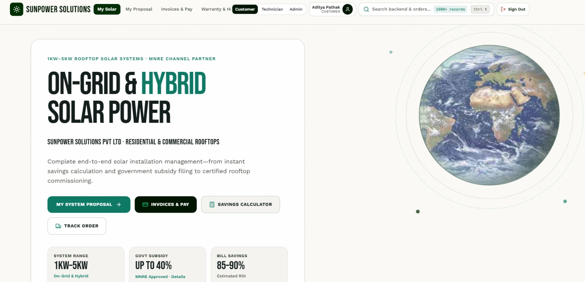
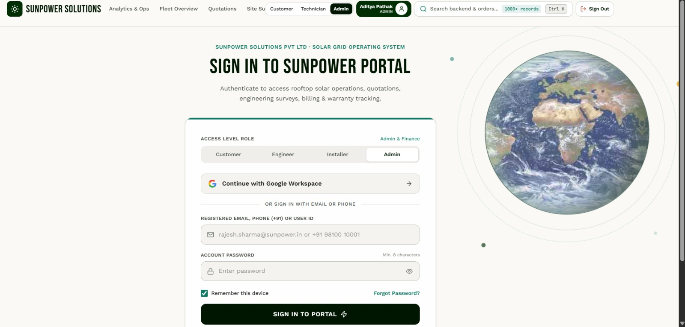

# SunPower SIMS





SunPower SIMS (Solar Installation Management System) is an enterprise-grade solar EPC and operations management platform designed for residential and commercial rooftop solar installations in India. It provides an end-to-end operational workspace spanning lead intake, irradiance savings calculators, engineering site surveys, turnkey dynamic Bill of Materials (BoM) quotations, PM Surya Ghar central subsidy workflows, milestone payments with automated GST invoicing, warehouse serial number tracking, commissioning QA with customer e-signatures, 20-to-25-year statutory warranty registries, and zero-click service helpdesk ticketing.

The repository is structured into two core layers:

- `frontend`: React / Tailwind CSS single-page application with responsive operator consoles and public solar calculator
- `backend` (and `app`): Asynchronous FastAPI (Python 3.13) service, SQLAlchemy 2.0 Async ORM with `asyncpg`, Alembic migrations, Redis cache, and PostgreSQL schema

## Features

- Dual-token JWT authentication (60-minute access token, 7-day refresh token) with Bcrypt password hashing
- Role-Based Access Control (RBAC) across 6 discrete actors (`SUPER_ADMIN`, `SALES_EXEC`, `SURVEY_TECH`, `INSTALL_TECH`, `WAREHOUSE_MGR`, `SUPPORT_AGENT`, and `CUSTOMER`)
- Stateless cryptographic OTP generation and verification via AES-256-CBC with HMAC integrity verification
- PostgreSQL 16 relational data layer with UUID primary keys and 3NF normalization
- Asynchronous non-blocking database queries with SQLAlchemy 2.0 and asyncpg connection pooling
- Automated PM Surya Ghar Muft Bijli Yojana subsidy calculator (1kW: ₹30,000, 2kW: ₹60,000, 3–10kW: ₹78,000 ceiling)
- Finite State Machine (FSM) tracking: Surveys, Quotations, Orders, Installations, and Service Tickets
- Turnkey dynamic Bill of Materials (BoM) explosion with hardware line pricing and labor cost segregation
- 3-stage milestone payment engine (10% Advance Booking, 70% Pre-Dispatch, 20% Commissioning)
- Automated GST tax invoicing (CGST 6.9% + SGST 6.9% on standard 13.8% renewable tariff structure)
- Razorpay / UPI sandbox payment gateway integration with simulated webhooks
- Serialized barcode scanning and tracking for solar PV modules and on-grid/hybrid inverters
- Field commissioning electrical QA verification (VOC, ISC, earth resistance tests) and customer sign-off
- Digital 20-to-25-year warranty card issuance and public QR-code serial verification
- Service helpdesk with fault code directory, SLA timers, customer confirmation, and RMA tracking
- Geo-attendance tracking for rooftop engineering crews with GPS coordinates
- Executive analytics dashboard computing dynamic project-wise P&L from live order and BoM snapshots
- Odoo ERP JSON-RPC 2.0 compatibility bridge for bi-directional `crm.lead` synchronization
- Dual-mode deployment: decoupled with Vite reverse proxy or bundled as an ASGI static monolith

## Architecture

```text
React / Vite Frontend :5173 / :8000
          │
          │ REST / JSON / Bearer JWT / JSON-RPC
          ▼
FastAPI ASGI Backend (Python 3.13) :8000
   ├── Redis 8.x :6379 (Session cache, OTP expiry, token revocations)
   └── SQLAlchemy 2.0 (asyncpg)
          ▼
PostgreSQL 16 :5432 (sims_db)
```

The frontend never connects directly to the database. All data mutations occur via authenticated RESTful endpoints or the JSON-RPC bridge. Financial ledger updates, stock reservation adjustments, and warranty records are strictly enforced through transactional database operations.

## Repository Layout

```text
sunpower-solutions/
├── README.md
├── app/                           # Root FastAPI application
│   ├── api/
│   │   ├── deps.py                # OAuth2 & RBAC dependencies
│   │   └── v1/                    # API v1 route controllers (14 modules)
│   ├── core/                      # Config, async database, Redis, security, exceptions
│   ├── models/                    # Declarative SQLAlchemy 2.0 models
│   ├── schemas/                   # Pydantic v2 validation contracts
│   ├── services/                  # Business logic & calculation engines
│   └── main.py                    # FastAPI ASGI application entrypoint
├── backend/                       # Decoupled backend mirror
├── frontend/                      # React 18 + Vite frontend
│   ├── src/
│   │   ├── components/            # Sidebar, UI controls, role switcher
│   │   ├── views/                 # 14 ERP views (CRM, Survey, Quotes, Orders, etc.)
│   │   ├── utils/                 # Calculations, PDF export, synthetic fallbacks
│   │   ├── api.js                 # Unified API client & endpoint contracts
│   │   └── App.jsx                # Application shell & module state
│   ├── vite.config.js             # Vite proxy configuration
│   └── package.json
├── web/                           # React 19 + TypeScript modern UI build & screenshots
│   ├── src/
│   ├── dist/                      # Compiled production assets
│   └── package.json
├── alembic/                       # Database schema migrations
├── seed_data.py                   # Idempotent demo database seeder
├── requirements.txt               # Python package dependencies
└── .env                           # Root environment configuration
```

## Requirements

- Python 3.13 or newer
- Node.js 20 or newer
- npm
- PostgreSQL 16 or newer (via Homebrew on macOS or Docker)
- Redis 7 or newer (via Homebrew on macOS or Docker)

## Local Setup

### 1. Start PostgreSQL, Redis, and the Backend

Start PostgreSQL and Redis services (using Homebrew on macOS):

```bash
brew services start postgresql@16
brew services start redis
```

Create the PostgreSQL database and user:

```bash
psql postgres -c "CREATE DATABASE sims_db;"
psql postgres -c "CREATE USER postgres WITH PASSWORD 'postgres';"
psql postgres -c "GRANT ALL PRIVILEGES ON DATABASE sims_db TO postgres;"
psql postgres -c "ALTER USER postgres WITH SUPERUSER;"
```

Install backend dependencies and seed the database:

```bash
cd /Users/priyanshuraj/Downloads/sunpower-solutions
pip install -r requirements.txt
python3 -c "import asyncio; from app.core.database import engine, Base; from app.models import *; asyncio.run(engine.begin().then(lambda c: c.run_sync(Base.metadata.create_all)))"
python3 seed_data.py
```

Start the FastAPI application:

```bash
python3 -m uvicorn app.main:app --host 0.0.0.0 --port 8000 --reload
```

The API will be available at `http://localhost:8000`, with interactive Swagger documentation at `http://localhost:8000/docs`.

### 2. Start the Frontend

Open a second terminal window:

```bash
cd /Users/priyanshuraj/Downloads/sunpower-solutions/frontend
npm install
npm run dev
```

Open `http://localhost:5173`.

Vite automatically proxies all `/api`, `/v1`, and `/health` requests to the backend at `http://127.0.0.1:8000`.

Alternatively, opening `http://localhost:8000/` in your browser directly serves the compiled single-page application from the ASGI backend without needing a separate frontend process.

### 3. Demo Credentials

The database seeder creates default accounts for every role:

| Role | Username / Email | Password | Primary Permissions |
| :--- | :--- | :--- | :--- |
| **Super Admin** | `admin@sims.com` | `Admin@12345` | Universal system access, P&L analytics, user governance |
| **Sales Executive** | `sales@sims.com` | `Sales@12345` | Leads, CRM, survey reviews, quotation generation |
| **Lead Installation Tech** | `tech@sims.com` | `Tech@12345` | Assigned surveys, electrical test uploads, customer handover |
| **Demo Accounts** | `demo.001@sunpower.demo` | `Demo@12345` | Standard field and warehouse operational testing |

## Services and Documentation

| Service | URL |
| :--- | :--- |
| Frontend Dev Server | `http://localhost:5173` |
| Unified Backend & Production UI | `http://localhost:8000` |
| Swagger UI (OpenAPI Interactive Docs) | `http://localhost:8000/docs` |
| ReDoc API Documentation | `http://localhost:8000/redoc` |
| OpenAPI Schema (JSON) | `http://localhost:8000/openapi.json` |
| System Health Probe | `http://localhost:8000/health` |
| PostgreSQL Database | `localhost:5432` (`sims_db`) |
| Redis In-Memory Store | `localhost:6379` |

## API

Base URL:

```text
http://localhost:8000/api/v1
```

Protected requests use:

```http
Authorization: Bearer <accessToken>
Content-Type: application/json
```

Successful responses adhere to the standard generic envelope:

```json
{
  "success": true,
  "data": {},
  "message": "Operation successful",
  "timestamp": "2026-11-22T04:30:00.000000+00:00"
}
```

Error responses adhere to:

```json
{
  "success": false,
  "error": {
    "code": "FORBIDDEN",
    "message": "Role 'customer' is not authorized to access this resource.",
    "details": null
  },
  "timestamp": "2026-11-22T04:30:00.000000+00:00"
}
```

### Authentication & RBAC

| Method | Route | Access | Purpose |
| :--- | :--- | :--- | :--- |
| `POST` | `/auth/login` | Public | Authenticate with email/phone & password |
| `POST` | `/auth/register` | Public | Customer self-registration |
| `POST` | `/auth/request-otp` | Public | Send 6-digit OTP to mobile |
| `POST` | `/auth/verify-otp` | Public | Verify OTP and issue JWT session |
| `POST` | `/auth/google` | Public | Verify Google Identity Services ID token |
| `GET` | `/auth/google/config` | Public | Fetch client configuration for Google Sign-In |
| `POST` | `/auth/refresh` | Public | Refresh expired access token |
| `GET` | `/auth/me` | Required | Retrieve current authenticated user profile |
| `POST` | `/v1/otp/generate` | Public | Generate stateless AES-256-CBC OTP token |
| `POST` | `/v1/otp/verify` | Public | Validate stateless offline OTP token |

### Public & Solar Calculator

| Method | Route | Purpose |
| :--- | :--- | :--- |
| `POST` | `/public/calculator/evaluate` | Calculate system sizing, generation, cost, subsidy & 25-yr ROI |
| `GET` | `/public/subsidy-info` | Fetch PM Surya Ghar Muft Bijli Yojana central subsidy policy brackets |
| `GET` | `/public/products-showcase` | List curated standard solar packages for public display |
| `POST` | `/public/enquiry` | Capture homeowner lead intake |

### Customer Management & CRM

| Method | Route | Purpose |
| :--- | :--- | :--- |
| `GET` | `/customers` | List customer accounts and KYC verification status |
| `GET` | `/customers/:id` | Get customer details (customers restricted to own record) |
| `POST` | `/customers` | Create new customer account |
| `PUT` | `/customers/:id` | Update customer address and electricity meter details |
| `GET` | `/leads` | List sales leads with pipeline status |
| `PUT` | `/leads/:id` | Update lead qualification or assign sales rep |

### Site Survey & Feasibility

| Method | Route | Purpose |
| :--- | :--- | :--- |
| `POST` | `/surveys/schedule` | Schedule rooftop technical survey |
| `GET` | `/surveys/assigned` | List surveys assigned to current technician or rep |
| `POST` | `/surveys/:id/submit-report` | Submit tilt, azimuth, shadow-free area & cable distance measurements |
| `PUT` | `/surveys/:id/approve` | Engineer approval of structural and electrical feasibility |

### Quotations & Dynamic BoM

| Method | Route | Purpose |
| :--- | :--- | :--- |
| `POST` | `/quotations/generate` | Compute dynamic BoM snapshot, tariff calculations, and turnkey quote |
| `GET` | `/quotations` | List all quotations (filtered for customer access) |
| `GET` | `/quotations/:id` | Get quotation details and itemized BoM lines |
| `POST` | `/quotations/:id/approve` | Customer acceptance / lock quotation for order conversion |

### Orders & Milestone Payments

| Method | Route | Purpose |
| :--- | :--- | :--- |
| `POST` | `/orders/create-from-quote` | Convert approved quotation to sales order and auto-generate 3 milestones |
| `GET` | `/orders` | List sales orders and balance due |
| `GET` | `/orders/:id` | Get sales order details |
| `PUT` | `/orders/:id/status` | Advance order state machine |
| `GET` | `/payments/order/:order_id/milestones` | Fetch 3 payment milestones (Advance, Pre-Dispatch, Commissioning) |
| `POST` | `/payments/create-order` | Initialize Razorpay / UPI checkout order for a milestone |
| `POST` | `/payments/simulate-success/:milestone_id` | Confirm milestone payment, update order balance & issue GST tax invoice |
| `PUT` | `/payments/milestones/:id` | Update milestone payment percentage or schedule |

### Inventory & Warehouses

| Method | Route | Purpose |
| :--- | :--- | :--- |
| `GET` | `/inventory/products` | List warehouse product catalog and specifications |
| `POST` | `/inventory/products` | Create SKU (panels, inverters, cables, structures, BOS) |
| `GET` | `/inventory/products/:id` | Get product details |
| `PUT` | `/inventory/products/:id` | Update SKU specification or pricing |
| `DELETE` | `/inventory/products/:id` | Archive SKU |
| `GET` | `/inventory/low-stock-alerts` | Identify stock balances below safety threshold |
| `GET` | `/inventory/warehouses` | List operational regional warehouses |
| `PUT` | `/inventory/:product_id/stock` | Update stock quantity on hand and reserved buffer |
| `POST` | `/inventory/:product_id/restock` | Record warehouse receiving batch |

### Dispatch & Serial Tracking

| Method | Route | Purpose |
| :--- | :--- | :--- |
| `GET` | `/dispatch/serials` | List serialized components mapped to an order |
| `POST` | `/dispatch/scan-serial` | Scan barcode to bind panel/inverter serial number to an order |
| `POST` | `/dispatch/confirm-shipment/:order_id` | Verify all required serials and dispatch shipment |

### Installations & Commissioning

| Method | Route | Purpose |
| :--- | :--- | :--- |
| `GET` | `/installations` | List installation jobs |
| `GET` | `/installations/assigned` | List jobs assigned to current lead technician |
| `POST` | `/installations/:id/progress-step` | Update checklist (mounting, panels, inverter wiring, earthing pits) |
| `POST` | `/installations/:id/test-results` | Record electrical test parameters (VOC, ISC, earth resistance) |
| `POST` | `/installations/:id/handover` | Capture customer digital signature and commission plant |

### Warranties & Service Helpdesk

| Method | Route | Purpose |
| :--- | :--- | :--- |
| `GET` | `/warranties/my-warranties` | List active digital warranties for current user |
| `GET` | `/warranties/verify/:serial_number` | Public QR code verification of component warranty status |
| `GET` | `/maintenance/tickets` | List maintenance and service tickets |
| `GET` | `/maintenance/fault-codes` | Directory of solar inverter and grid fault codes |
| `POST` | `/maintenance/tickets` | Open service ticket with priority level and fault categorization |
| `PUT` | `/maintenance/tickets/:id/resolve` | Technician resolution log, parts replacement, and hours worked |
| `POST` | `/maintenance/tickets/:id/confirm` | Customer digital sign-off and ticket closure |

### Crew Management & Analytics

| Method | Route | Purpose |
| :--- | :--- | :--- |
| `GET` | `/employees` | List employee directory, roles, and status |
| `POST` | `/employees/attendance/check-in` | Geo-tagged check-in with latitude and longitude |
| `GET` | `/employees/attendance` | Audit crew daily attendance logs |
| `GET` | `/analytics/dashboard` | Executive P&L, contract revenue, installed kW, and subsidy receivables |
| `POST` | `/jsonrpc` | Odoo CRM JSON-RPC 2.0 bridge for `crm.lead` ingestion |

## Solar EPC & Safety Rules

- All primary keys are immutable UUIDs.
- Product SKUs and Serial Barcodes are globally unique.
- Serialized equipment (solar panels, inverters) requires warehouse barcode scanning prior to dispatch.
- Milestone payments split net payable contract amount into 10% Advance Booking, 70% Pre-Dispatch, and 20% Commissioning.
- Pre-dispatch payment milestone must be satisfied before warehouse status transitions to `READY_FOR_DISPATCH`.
- Commissioning requires electrical test verification (VOC, ISC, and Earth Resistance < 5 Ohms) followed by customer signature.
- Plant commissioning atomically activates 25-year solar module performance warranties and 5-to-10-year inverter warranties.
- Validated milestone payments automatically generate legal GST Tax Invoices (`INV-SIMS-XXXXX`) calculating CGST and SGST splits.
- Financial P&L metrics dynamically compute COGS (quotation hardware baseline + direct labor) against total revenue including subsidy.

## Frontend Screens & Visual Previews

The frontend supports navigation across these core modules:

```text
/#/public          # Public Solar Landing Page & Showcase
/#/calculator      # Rooftop Sizing & PM Surya Ghar Subsidy Calculator
/#/enquiry         # Lead Intake & Consultation Booking
/#/signin          # Dual Login (Email/Password, Mobile OTP, Google Sign-In)
/#/signup          # Customer Self-Registration
/#/crm             # Customer CRM & Pipeline Management
/#/surveys         # Rooftop Engineering Feasibility & Shading Analysis
/#/quotations      # Dynamic BoM Generation & Turnkey Proposals
/#/orders          # Orders & 3-Stage Milestone Payment Collection
/#/inventory       # Warehouse Stock, BoM Templates & Low-Stock Alerts
/#/dispatch        # Barcode Scanning & Hardware Serial Tracking
/#/installations   # Field Crew Checklists, Electrical Tests & Commissioning
/#/warranty        # Digital Warranty Registry & Public QR Verification
/#/helpdesk        # Service Tickets, Inverter Fault Codes & RMA Dispatch
/#/employees       # Employee Directory & Geo-Tagged Attendance
/#/analytics       # Executive Dashboard & Project-Wise Dynamic P&L
/#/admin           # Super Admin Console (User, Role & System Governance)
```

### Authentication & Role Governance Console

*Secure authentication supporting email/password, OTP recovery, and 1-click persona switching across Customer, Sales, Field Technician, Warehouse, Support, and Admin.*

### Executive Admin & Dynamic P&L Dashboard

*Real-time executive oversight tracking total turnkey revenue, hardware COGS, direct labor expenses, gross margin percentages, and project-wise profitability.*
## Development Commands

### Backend

```bash
# Start development server with hot-reload
python3 -m uvicorn app.main:app --host 0.0.0.0 --port 8000 --reload

# Run database table creation
python3 -c "import asyncio; from app.core.database import engine, Base; from app.models import *; asyncio.run(engine.begin().then(lambda c: c.run_sync(Base.metadata.create_all)))"

# Seed repeatable demo records
python3 seed_data.py

# Run Alembic migrations
python3 -m alembic upgrade head

# Run automated tests
pytest
```

### Frontend

```bash
cd frontend

# Install npm dependencies
npm install

# Start Vite development server
npm run dev

# Compile production bundle
npm run build

# Preview production build locally
npm run preview
```

## Environment Variables

Backend `.env`:

```env
# Server & Environment
PROJECT_NAME="Solar Installation Management System"
ENVIRONMENT="development"
DEBUG=True
API_V1_STR=/api/v1

# PostgreSQL Database
POSTGRES_SERVER=localhost
POSTGRES_PORT=5432
POSTGRES_USER=postgres
POSTGRES_PASSWORD=postgres
POSTGRES_DB=sims_db

# Redis In-Memory Store
REDIS_HOST=localhost
REDIS_PORT=6379

# JWT Authentication
SECRET_KEY=sims_super_secret_jwt_key_2026_production_grade_random_seed
ACCESS_TOKEN_EXPIRE_MINUTES=60
REFRESH_TOKEN_EXPIRE_DAYS=7
OTP_MAX_ATTEMPTS=5

# Payment Gateway (Razorpay Sandbox)
RAZORPAY_KEY_ID=rzp_test_U2zPS64W6PWk5v
RAZORPAY_KEY_SECRET=RNT24DdAZPKPJi3WgsyktYqa

# Google Identity Services
GOOGLE_CLIENT_ID=715627477785-j4267gp42b9qr8qusng7h864o6tgjq61.apps.googleusercontent.com

# CORS Allowed Origins
BACKEND_CORS_ORIGINS=["http://localhost:5173","http://localhost:3000","http://localhost:8000","http://127.0.0.1:5173","http://127.0.0.1:3000","http://127.0.0.1:8000"]
```

Frontend `.env` (`frontend/.env`):

```env
VITE_API_BASE_URL=http://localhost:8000
VITE_API_V1=/api/v1
VITE_BACKEND_PORT=8000
VITE_FRONTEND_PORT=5173
VITE_RAZORPAY_KEY_ID=rzp_test_U2zPS64W6PWk5v
VITE_GOOGLE_CLIENT_ID=715627477785-j4267gp42b9qr8qusng7h864o6tgjq61.apps.googleusercontent.com
```

## Troubleshooting

### PostgreSQL connection refused (`ConnectionRefusedError: [Errno 61]`)

Confirm the PostgreSQL service is active on port `5432`:

```bash
brew services list | grep postgresql
pg_isready -h localhost -p 5432
```

If stopped, restart the service:

```bash
brew services restart postgresql@16
```

### Missing Python dependencies (`greenlet`, `pydantic-settings`, `email-validator`)

Install all required packages from `requirements.txt`:

```bash
pip install -r requirements.txt
pip install "pydantic[email]" email-validator greenlet pydantic-settings
```

### Role authorization error on Analytics page (`Role 'install_tech' is not authorized`)

Ensure your user account has internal staff permissions. The analytics endpoint `/api/v1/analytics/dashboard` allows all staff roles (`SUPER_ADMIN`, `SALES_EXEC`, `INSTALL_TECH`, `SURVEY_TECH`, `WAREHOUSE_MGR`). For full administrator privileges, sign in using `admin@sims.com` / `Admin@12345`.

### Frontend proxy timeout or network errors

Verify both backend and frontend ports:
- Backend must be listening on port `8000`: `lsof -i :8000`
- Frontend Vite dev server runs on port `5173`: `lsof -i :5173`
- Ensure `frontend/vite.config.js` contains the `/api`, `/v1`, and `/health` proxy rules targeting `http://127.0.0.1:8000`.

## License

This project was developed as an enterprise solution for SunPower Solutions.
